<div align="center">

# 🏛️ CONNAUGHT PLACE (PUNE EDITION)
### *“PUNE KO SURVIVE MAT KARO. JEEYO.”*

**Built in a 3-Hour Rapid Frontend Battle at PromptWars × BRAIN DYPCOEI**

[](https://github.com/656yash/Connaught-Place)
[](https://github.com/656yash/Connaught-Place)
[](https://nextjs.org/)
[](https://react.dev/)
[](https://tailwindcss.com/)
[](https://jestjs.io/)

<p align="center">
  <b>An AI-powered, sticker-bombed, neo-brutalist interactive guide celebrating Pune's beating heart — from Irani chai to midnight misal, street bargaining to historic wadas.</b>
</p>

[Explore Live CP](#-getting-started) • [The Hackathon Story](#-about-promptwars--brain-dypcoei) • [Key Features](#-features) • [Vibe-Coding Approach](#-vibe-coding-methodology) • [Tech Stack](#%EF%B8%8F-tech-stack)

---

</div>

## ⚡ About PromptWars × BRAIN DYPCOEI

> **"PromptWars × BRAIN DYPCOEI is an AI-powered vibe-coding hackathon where participants solve real-world challenges through prompting, rapid prototyping, and creative use of AI. Build fast, think differently, and turn your prompts into working solutions."**

In this high-intensity **3-Hour Frontend Battle**, the goal wasn't just to write code — it was to master human-AI synergy:
- **Zero to Production in 180 Minutes**: Moving from an abstract cultural concept to a fully responsive, animated, test-covered, and secure web application.
- **Thinking Differently**: Replacing generic corporate UI templates with an authentic, punchy **Desi Neo-Brutalist & Riso Pop-Art** aesthetic inspired by Pune's streets.
- **Vibe-Coding with Rigor**: Balancing speed with software engineering fundamentals — strict security headers, accessible HTML5 semantics, and automated Jest test suites.

---

## 🎨 The Concept: Connaught Place (Pune Edition)

Delhi has Connaught Place. But anyone who knows Pune knows that the real pulse of the city runs through its own labyrinth of bakeries, peths, street markets, and hangout spots. 

**Connaught Place (Pune Edition)** is an interactive hyper-local city atlas built with:
- **Bhau Billa Mascot**: The animated, tap-friendly local guide.
- **Sticker-Bomb Aesthetics**: Offset shadows (`box-shadow: 5px 5px 0px #181926`), bold typography, playful marquee banners, and retro paper textures.
- **Bilingual Puneri Slang**: Rooted in genuine city banter (*“Sab Raste CP Se Jaate Hain”*, *“Khao • Ghoomo • Kharido”*).

---

## 🚀 Features

### 1. 🗺️ Interactive Explore Engine
- Full-screen split-view navigation powered by **MapLibre GL**.
- Deep-linking via query parameters (`?place=p1`) to jump directly to iconic hotspots.
- Live categorization filters: *Veg Only*, *Trendy*, *Late Night*, *Aesthetic*.

### 2. 🍲 KHAO (The Food Trail)
- Curated index of Pune’s culinary staples:
  - **Bedekar Misal** (Narayan Peth)
  - **Cafe Goodluck** (Deccan Gymkhana Irani Chai & Bun Maska)
  - **Camp Burger** & **Kayani Bakery** (Mawa cakes & Shrewsbury biscuits)
  - **Vaishali** & **Sujata Mastani**

### 3. 🛍️ KHARIDO (Street Shopping Radar)
- Pocket-friendly shopping map covering **FC Road**, **Tulsi Baug**, **Clover Centre**, and modern hubs like **Phoenix Mall**.
- Transparent pricing and bargaining cheat sheets.

### 4. ⚡ LIVE (City Pulse & Nightlife)
- Real-time pulse tracking Pune's youth spots, live gigs, and student culture around Koregaon Park and FC Road.

### 5. 🏛️ HERITAGE & GHOOMO
- Exploring the historical wadas (**Shaniwar Wada**), ancient rock-cut caves (**Pataleshwar**), **Aga Khan Palace**, and hilltop retreats (**Sinhagad Fort**).

### 6. ⚔️ The CP Showdown (Delhi CP vs Pune CP)
- A tongue-in-cheek cultural comparison roast celebrating Pune's unmatched chill-vibe over Delhi's bureaucratic geometry.

---

## 🧠 Vibe-Coding Methodology: 3-Hour Sprint Breakdown

```mermaid
gantt
    title 3-Hour PromptWars Frontend Battle Timeline
    dateFormat  m
    axisFormat  %M min
    section Ideation & Aesthetics
    Concept & Theme Definition           :done, 0, 20
    Riso & Neo-Brutalist Design Tokens   :done, 20, 45
    section Rapid Prototyping
    Landing Page & Bhau Billa Mascot     :done, 45, 80
    MapLibre GL Interactive Explorer     :done, 80, 120
    Category Pages (Food, Live, Shop)    :done, 120, 145
    section Hardening & Polish
    Automated Jest Tests & A11y Audit    :done, 145, 165
    Security Headers Middleware & Build  :done, 165, 180
```



1. **System Prompt Design**: Establishing custom color tokens (`--color-ivory`, `--color-haldi`, `--color-bubblegum`, `--color-sindoor`, `--color-navy`) and typography before generating components.
2. **Component Composition**: Rapidly synthesizing reusable micro-components using Tailwind CSS v4 and Framer Motion.
3. **Resilience & QA**: Integrating Next.js edge middleware for strict security headers and building automated unit tests with `@testing-library/react`.

---

## 🛠️ Tech Stack

| Layer | Technology | Purpose |
|---|---|---|
| **Framework** | **Next.js 16.4 (App Router)** | Zero-config SSR and Turbopack lightning-fast HMR |
| **UI Engine** | **React 19** | Modern concurrent rendering and transition states |
| **Styling** | **Tailwind CSS v4** | Modern utility-first design system & custom sticker borders |
| **Animations** | **Framer Motion** + Custom CSS | Sticker float physics, endless marquee, hover scale micro-interactions |
| **Mapping** | **MapLibre GL** | High-performance client-side interactive map vector tiles |
| **Icons** | **Lucide React** | Crisp, scalable SVG icons |
| **Security** | **Next.js Middleware** | HSTS, X-Frame-Options, XSS protection, DNS prefetch |
| **Testing** | **Jest + Testing Library** | Unit testing landing page, food components, accessibility |

---

## 💻 Getting Started

### Prerequisites
- Node.js 18+ or 20+
- npm, yarn, or pnpm

### 1. Clone & Install
```bash
git clone https://github.com/656yash/Connaught-Place.git
cd Connaught-Place
npm install
```

### 2. Run the Development Server
```bash
npm run dev
```
Open **[http://localhost:3000](http://localhost:3000)** in your browser to experience the vibe.

### 3. Run Test Suite
```bash
npm test
```

### 4. Build for Production
```bash
npm run build
npm start
```

---

## 🏆 Hackathon Acknowledgements

- **Event:** **PromptWars × BRAIN DYPCOEI**
- **Organizers:** BRAIN DYPCOEI (Dr. D. Y. Patil College of Engineering and Innovation)
- **Built by:** [@656yash](https://github.com/656yash)

---

<div align="center">
  <b>Built with ❤️, chai, and prompt engineering in 3 intense hours.</b><br/>
  <i>“Pune ko survive mat karo. Jeeyo!”</i>
</div>
